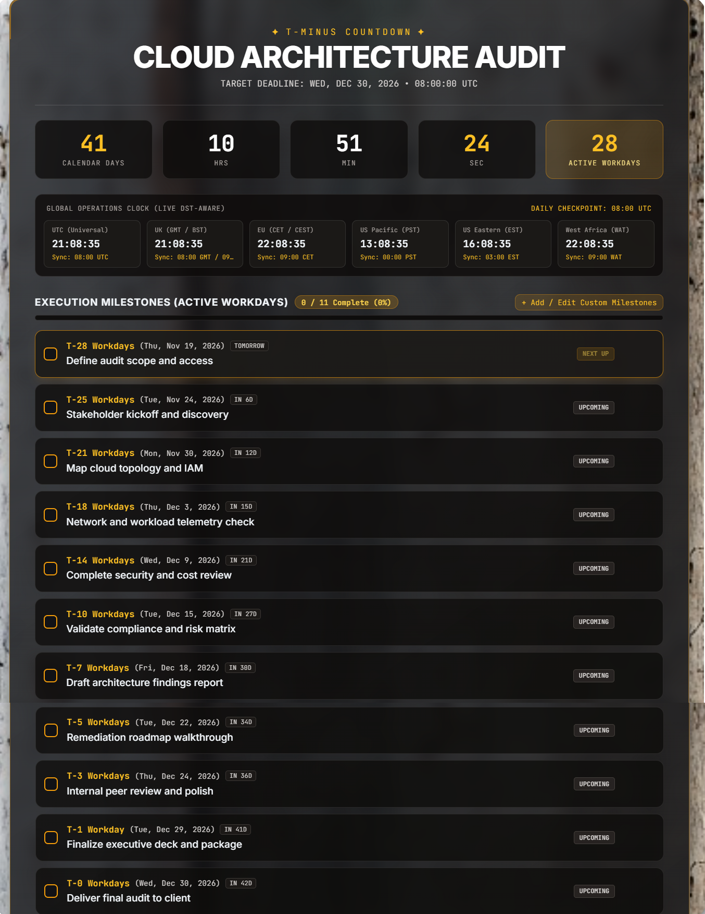

# T-MINUS COUNTDOWN: CLOUD ARCHITECTURE AUDIT

[](https://cloud-architecture-audit-app.vercel.app/)
[](https://github.com/sampeter-akan/cloud-architecture-audit-app)
[](#system-architecture--data-flow)



> **Executive Summary:** An interactive **T-Minus Mission Countdown & `1920x1080` Desktop Lock Screen Generator** built to orchestrate the **Cloud Architecture Audit** client deliverable targeting **Wednesday, December 30, 2026 at 08:00:00 UTC**. Designed for distributed cloud engineering and governance teams, it combines real-time multi-timezone telemetry, an active-workday backward execution schedule, stateless URL-encoded state sharing, one-click `.ics` calendar provisioning, and an HTML5 Canvas desktop lock screen exporter.

---

## Live Production Deployment

* **Production URL:** <https://cloud-architecture-audit-app.vercel.app/>
* **Source Repository:** <https://github.com/sampeter-akan/cloud-architecture-audit-app>

---

## System Architecture & Data Flow

Engineered as a **zero-build, zero-backend single-page application (`index.html`)**, the system eliminates server runtime overhead, database latency, and PII exposure while maintaining full multi-device state portability.

```text
+-----------------------------------------------------------------------------------+
|                        CLIENT RUNTIME (Single-File index.html)                    |
|                                                                                   |
|  +-----------------------+     +-----------------------+     +-----------------+  |
|  |   Telemetry Engine    |     |  Active-Workday Eng.  |     |  State Manager  |  |
|  | • 1Hz UTC Ticker      |     | • Mon–Fri Filter      |     | • URL Hash (#s) |  |
|  | • Intl.DateTimeFormat |     | • Holiday Exclusions  |     | • Query (?done) |  |
|  |   (UTC/UK/EU/US/WAT)  |     |   (Dec 25 & Dec 28)   |     | • LocalStorage  |  |
|  +-----------+-----------+     +-----------+-----------+     +--------+--------+  |
|              |                             |                          |           |
|              +-----------------------------+--------------------------+           |
|                                            |                                      |
|                                            v                                      |
|              +--------------------------------------------------------+           |
|              |          Reactive Glassmorphic UI & Renderer           |           |
|              |  • Frosted Charcoal Card + Weathered Wood Backdrop     |           |
|              |  • Dynamic Status Badges (COMPLETED / NEXT UP / DUE)   |           |
|              +------+----------------------+-------------------+------+           |
|                     |                      |                   |                  |
+---------------------|----------------------|-------------------|------------------+
                      |                      |                   |
                      v                      v                   v
       +-----------------------------+  +----------+  +-----------------------+
       |  HTML5 Offscreen Canvas     |  | RFC 5545 |  | Standalone Snapshot   |
       |  • Composites bg + UI card  |  | .ics Gen |  | • Serializes custom   |
       |  • Exports 1920x1080 PNG    |  | • 08:00Z |  |   milestones into     |
       |    for OS Lock Screens      |  |   Alarms |  |   downloadable HTML   |
       +-----------------------------+  +----------+  +-----------------------+
```

### Architectural Highlights for Technical Reviewers
* **Zero-Build Portability:** Written in semantic HTML5, Tailwind CSS (CDN), and vanilla ES6+ JavaScript—requiring zero `node_modules`, bundlers, or external API keys.
* **Stateless URL State Serialization:** Every checkbox toggle or custom milestone edit is Base64-encoded into the URL hash (`#s=`) and query string (`?done=`), enabling instant link sharing across teams without backend storage.
* **Client-Side Graphics Compositing:** Uses an offscreen `<canvas>` pipeline (`1920x1080`) to merge `background-img.jpg` with live milestone state, typography, and trademark watermarks into a ready-to-apply desktop wallpaper.
* **Privacy-First Design:** Zero user telemetry, cookies, or personal contact data collected or transmitted.

---

## Executive Capabilities

1. **Real-Time T-Minus & Active-Workday Telemetry:**
   * Live second-by-second countdown (`Calendar Days`, `Hours`, `Minutes`, `Seconds`) synchronized to **December 30, 2026 at 08:00:00 UTC**.
   * **Active Workday Calculator:** Automatically filters out weekends (Saturday/Sunday) and year-end Christmas holiday observances (`Dec 25` and `Dec 28, 2026`) to display true remaining execution workdays alongside clearly labeled `T-X Workdays` milestones.

2. **Global Multi-Timezone Synchronization (DST-Aware):**
   * Anchored universally at **08:00 UTC** with live conversions across key operational hubs via the browser's `Intl.DateTimeFormat` engine:
     * **UTC (Universal):** `08:00 UTC`
     * **United Kingdom (GMT / BST):** `08:00 GMT / 09:00 BST`
     * **European Union (CET / CEST):** `09:00 CET`
     * **US Pacific (PST / PDT):** `00:00 PST`
     * **US Eastern (EST / EDT):** `03:00 EST`
     * **West Africa Time (WAT):** `09:00 WAT`

3. **Interactive 11-Checkpoint Audit Roadmap:**
   * Tracks 11 concise, under-five-word milestones from **T-28 Workdays** through **T-0 Workdays** with automatic status indicators (`COMPLETED`, `NEXT UP`, `UPCOMING`, `OVERDUE`), live progress bar calculation, and full CRUD support for adding or editing custom checkpoints.

4. **Distraction-Free Lock Screen Mode & `1920x1080` PNG Exporter:**
   * **Lock Screen Mode (`ESC` to exit):** Hides all configuration toolbars and leaves clean `14vh` headroom at the top for desktop clocks and OS icons.
   * **HTML5 Canvas PNG Exporter:** Renders a high-resolution `1920x1080` (`16:9`) wallpaper blending the weathered wood plank backdrop (`background-img.jpg`), frosted charcoal executive card, live checkbox states, and footer watermark.

---

## Backward T-Minus Execution Schedule (Active Workdays)

All milestones are scheduled at **08:00 UTC** on active Monday–Friday business days (excluding December 25 & December 28 public holiday observances):

| Countdown (Workdays) | Scheduled Date | Milestone Deliverable | Governance Focus |
| :--- | :--- | :--- | :--- |
| **T-28 Workdays** | Thu, Nov 19, 2026 | Define audit scope and access | Governance & IAM Onboarding |
| **T-25 Workdays** | Tue, Nov 24, 2026 | Stakeholder kickoff and discovery | Architecture Baseline Alignment |
| **T-21 Workdays** | Mon, Nov 30, 2026 | Map cloud topology and IAM | Network & Identity Inventory |
| **T-18 Workdays** | Thu, Dec 3, 2026 | Network and workload telemetry check | Observability & Logging Audit |
| **T-14 Workdays** | Wed, Dec 9, 2026 | Complete security and cost review | Posture & FinOps Optimization |
| **T-10 Workdays** | Tue, Dec 15, 2026 | Validate compliance and risk matrix | Control Mapping & Gap Scoring |
| **T-7 Workdays** | Fri, Dec 18, 2026 | Draft architecture findings report | Technical Documentation |
| **T-5 Workdays** | Tue, Dec 22, 2026 | Remediation roadmap walkthrough | Prioritized Action Plan |
| **T-3 Workdays** | Thu, Dec 24, 2026 | Internal peer review and polish | Quality Assurance Sign-Off |
| **T-1 Workday** | Tue, Dec 29, 2026 | Finalize executive deck and package | Deliverable Packaging |
| **T-0 Workdays** | Wed, Dec 30, 2026 | Deliver final audit to client | Final Client Handover |

---

## Repository Structure

```text
cloud-architecture-audit-app/
├── index.html              # Single-file application (UI, telemetry engine, Canvas PNG & ICS exporters)
├── background-img.jpg      # Full-bleed weathered vertical wood plank background asset
├── lockscreen-preview.png  # Exported 1920x1080 executive lock screen showcase image
└── README.md               # Executive documentation and system architecture guide
```

---

## Local Development & CI/CD Deployment

### Run Locally
Because the HTML5 Canvas PNG exporter reads `./background-img.jpg`, serve the directory over a local HTTP server to avoid browser `file://` CORS restrictions:

```bash
# Using Python 3
python -m http.server 8080
# Open http://localhost:8080 in your browser
```

### Continuous Deployment (GitHub → Vercel)
Any push to the `main` branch automatically triggers a zero-config production build on Vercel:

```bash
git add index.html README.md
git commit -m "chore: clarify active-workday milestone labels (T-28 Workdays to T-0 Workdays)"
git push origin main
```

---

## Copyright & Trademark

© 2026 **Samuel Peter™** • Cloud Architecture Audit Countdown. All Rights Reserved.